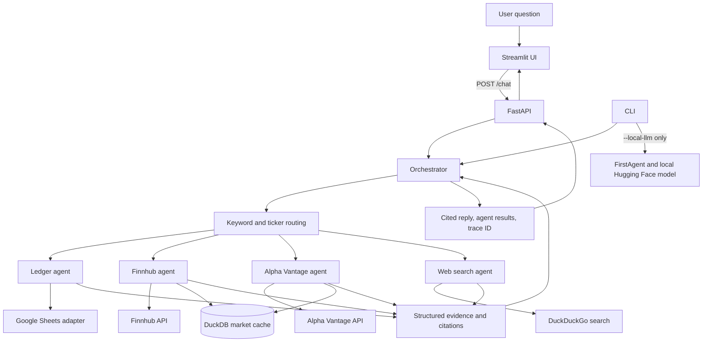

# Research-Agent Architecture

Source review: 2026-11-17. This describes implemented code separately from plans;
it is not a new live integration certification.

## Scope

The product direction is one research agent exposed through a reusable Python
service. CLI, FastAPI, and Streamlit are access points. React can later consume
the API. Additional autonomous specialists are deferred.

The current runtime uses deterministic specialist wrappers for ledger, ticker
quotes, FX rates, financial news, macro news, and web research. These are
connected code, not autonomous LLM agents.

## Folder Responsibilities

Package paths below are relative to `src/investment_agents/`.

| Folder or module | Existing responsibility |
| --- | --- |
| `cli.py` | Terminal interaction |
| `core/` | Configuration, local model wrapper, messages, trace recording |
| `agents/alphavantage_agent.py` | Ticker news and macro-news wrapper |
| `agents/web_search_agent.py` | Current web research and linked evidence |
| `agents/orchestrator.py`, `agents/routing.py` | Keyword routing and evidence synthesis |
| `agents/ledger_agent.py`, `agents/finnhub_agent.py` | Earlier ledger and quote wrappers |
| `tools/` | Finnhub, Alpha Vantage, web search, and Sheets adapters |
| `domain/` | Parsing, tickers, money and portfolio calculations |
| `storage/` | DuckDB market payload and FX storage |
| `api/` | HTTP routes and request/response contracts |
| `ui/` | Streamlit client and trace presentation |

The `scripts/` folder contains thin launchers for CLI, API, and Streamlit entry
points; application logic stays in the `src/investment_agents/` package. Root
`tests/` contains automated checks. See [SETUP.md](SETUP.md) for setup and
integration details. The ledger and quote modules are connected code, not disabled
archives.

## Runtime Today

The normal chat path returns one cited response to the UI. Specialist agents
retrieve evidence; the orchestrator routes the question and combines results.
The local Hugging Face model is a separate CLI option and is not part of the
default API or Streamlit response path.

The API returns updated chat history, but current routing and template synthesis
operate on the current question. Returning history does not establish contextual
reasoning. LLM settings alone do not enable an LLM workflow.

LangChain, `langchain-huggingface`, and LangGraph appear in `requirements.txt` but
are not imported by runtime code. There is no `StateGraph` or compiled graph.
The local chat model uses `transformers.pipeline` in `core/chat.py`.

Both Streamlit and local chat initialize history through `core/messages.py`.
Streamlit sends that system message to the API, but the template synthesizer does
not interpret it. See [the current prompt](RESEARCH_PROMPT.md).

Settings loaded through `get_settings()` read `.env`; `.env.example` is not loaded.
Streamlit's API URL is read directly from its process environment and editable
sidebar field. The documented local API port is 8001, while Compose still exposes
8000 and connects its UI internally to `http://api:8000`.

Quote and news tools run on requests. Continuous monitoring, 52-week-high checks,
moving-average calculations, and comprehensive political/economic research are
not implemented merely by describing them in the system prompt.

## API and Data

FastAPI exposes `/health`, `/agents`, `/tools/readiness`, `/storage/status`,
`POST /chat`, `/observability/events`, and `/observability/status`.
Chat responses contain `reply`, updated `chat`, `elapsed_seconds`, `model_id`,
`trace_id`, `selected_agents`, `agent_results`, `routing_decision`, `source_notes`,
and structured `citations`. Market and currency questions can combine live web
results with Finnhub quote/FX data and Alpha Vantage ticker/macro news. Citations
are attached to the evidence used in the response; unavailable sources are
reported rather than silently treated as evidence.

The ledger tool reads Google Sheets on demand. It parses transactions, holdings,
and an optional watchlist. The orchestrator can pass ledger-derived symbols to
market/research wrappers. Finnhub supplies quotes; Alpha Vantage supplies news
sentiment and macro news. Finnhub also supplies currency cross-rates, while web
search adds current public sources. DuckDB stores provider payloads, curated
snapshots, and FX rates.

To add a specialist, implement the shared `AnalysisAgent.analyze()` contract,
wire its adapter through `ToolRegistry`, then add its routing rule and response
evidence. The API contract remains reusable by CLI, Streamlit, and other clients.

Events record routing, specialist starts, and tool calls. Streamlit displays the
latest trace and renders the response's source links. Neither a health response nor
configured-tool status verifies a live provider call. See [SETUP.md](SETUP.md) for
configuration and error behavior.

## Remaining Work

Evidence-based LLM synthesis and LangGraph orchestration are not implemented.
Persistent conversational memory, scheduled monitoring, technical indicators,
and document retrieval are also outside the current runtime. Docker build recovery
and live integration checks remain separate verification tasks. The shared prompt
does not enable these features on its own.
